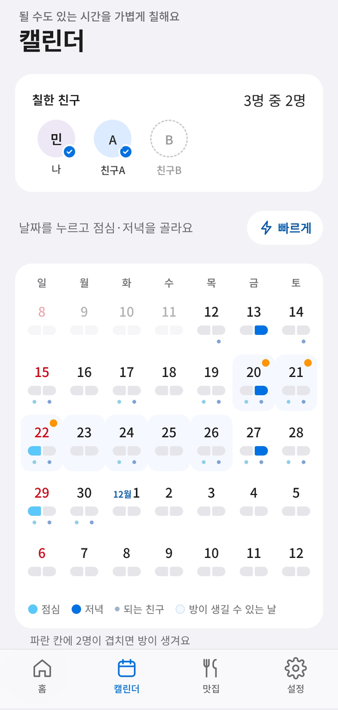

# 모일까

> 날짜 투표 없이, 칠해두기만 하면 약속이 잡히는 친구 모임 앱

**[앱 열어보기 →](https://moilkka-app.vercel.app)** · 모바일 웹앱 (홈 화면에 추가해서 사용)

<!-- 스크린샷을 docs/screenshots/ 에 넣은 뒤 아래 주석을 풀어주세요
<p>
  
  
  
</p>
-->

## 왜 만들었나요

친구들이 서로 다른 동네에 흩어져 살다 보니, 약속 한 번 잡으려면 단톡방에서 "언제 돼?"를 몇 번씩 돌려야 했어요. 날짜 투표 링크를 만들어도 누군가는 늦게 답하고, 결국 흐지부지되기 일쑤였죠.

그래서 방식을 뒤집었어요. **누가 먼저 날짜를 제안하는 대신, 각자 될 것 같은 날을 미리 칠해두면 앱이 알아서 겹치는 날을 찾아 방을 만들어요.** 실제로 우리 친구 모임에서 쓰고 있는 앱이에요.

## 이렇게 동작해요

1. **칠하기** — 캘린더에 될 수도 있는 점심·저녁을 칠해둬요. 친구들 눈에는 "몇 명이 칠했는지" 숫자만 보이고, 누가 칠했는지는 안 보여요.
2. **자동 방** — 8~14일 뒤 같은 끼니에 기준 인원 이상이 겹치면 방이 생기고 초대장이 가요.
3. **참석 / 패스** — 초대받은 사람은 참석이나 패스를 눌러요. 기준 인원이 참석하면 모임이 확정돼요.
4. **시간·맛집 정하기** — 확정된 방에서 시간(점심 11시·12시·1시 / 저녁 5시·5시 반·6시)과 식당을 하트로 골라요. 마감 때 1위로 자동 결정돼요.

이 밖에 직접 방 만들기(번개), 모임 맛집 풀(네이버 지도 링크 붙여넣기), 참석자끼리 방 대화, 푸시 알림이 있어요.

## 설계하면서 고민한 것

기능보다 **친구 사이에서 서운한 일이 생기지 않게** 하는 규칙을 정하는 데 시간을 가장 많이 썼어요.

- **패스는 본인에게만 보여요.** 누가 거절했는지 드러나면 부담스러우니까요.
- **방은 초대받은 사람에게만 보여요.** 일부만 모이는 약속이 있어도 나머지 친구가 소외감을 느끼지 않게 했어요.
- **중간 지점 찾기·정산 기능은 일부러 뺐어요.** "왜 우리 동네에서 멀어?" 같은 다툼거리가 될 수 있다고 봤어요.
- **한 사람이 여러 모임을 운영할 수 있지만, 모임끼리는 서로 존재를 몰라요.** 이름·멤버·일정 모두 서버 보안 규칙(RLS)에서 모임 단위로 막아요. 두 모임에 다 있는 사람만 "이날 저녁은 다른 모임이 있어요" 경고를 받아요.
- **무료로 운영해요.** 7~8명이 쓰는 앱이라 유료 서버 없이 무료 범위 안에서 돌아가게 설계했어요.

## 기술 스택

| 영역 | 사용한 것 |
| --- | --- |
| 화면 | HTML · CSS · JavaScript (빌드 과정 없는 정적 웹앱, PWA) |
| 서버·데이터베이스 | Supabase — Postgres, 익명 로그인, RLS 보안 규칙 |
| 자동 처리 | pg_cron (1분마다 방 생성·마감 처리), Edge Function (웹 푸시 알림) |
| 배포 | Vercel (GitHub에 올리면 자동 배포) |
| 기타 | GitHub Actions (무료 DB가 잠들지 않게 하루 한 번 깨우기) |

## 만든 방식

기획·화면 구성·운영 규칙은 제가 정하고, 코드는 AI(Claude)와 함께 작성했어요. 친구들과 실제로 써보면서 나온 불편함을 규칙으로 다듬는 과정을 반복했어요. 데이터베이스 변경 이력은 [`supabase/migrations`](supabase/migrations)에 순서대로 남아 있어요.

## 폴더 구조

```
index.html, app.js, styles.css   앱 화면
config.js                        Supabase 주소와 공개용 키
sw.js, manifest.webmanifest      홈 화면 설치용(PWA)
supabase/migrations/             테이블·보안 규칙·자동 처리 SQL (0001~0018)
supabase/functions/push/         푸시 알림 서버 함수
docs/SETUP.md                    직접 설치해서 운영하는 방법
```

직접 설치해서 쓰고 싶다면 [설치·운영 가이드](docs/SETUP.md)를 보세요.
